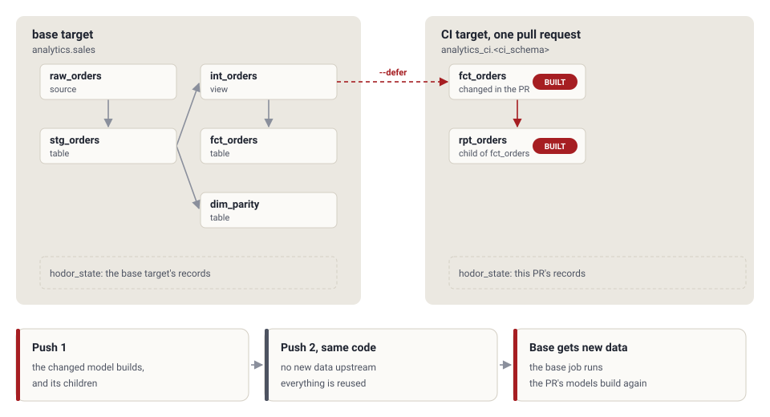

<!-- markdownlint-disable MD033 MD041 -->
<p align="center">
  <picture>
    <source media="(prefers-color-scheme: dark)" srcset="docs/assets/hodor-logo.svg">
    
  </picture>
</p>

<h1 align="center">dbt-hodor</h1>

<p align="center">
  <a href="https://github.com/alaturqua/dbt-hodor/actions/workflows/ci.yml"></a>
  
  
  
  <a href="https://alaturqua.github.io/dbt-hodor/"></a>
</p>

**[Documentation](https://alaturqua.github.io/dbt-hodor/)** | **[Interactive guide](https://alaturqua.github.io/dbt-hodor/guide/)** with a run simulator | **[Design spec](https://alaturqua.github.io/dbt-hodor/design/)**

dbt-hodor is a free, self-hosted alternative to dbt Labs' [dbt State](https://docs.getdbt.com/docs/deploy/dbt-state-about). It runs inside dbt. For every selected node it decides whether to reuse the object that is already in the warehouse or to build it again. A node is reused when its logic has not changed and its upstream data has not changed since the last build.

It needs no dbt platform account and sends nothing to external services. State lives in a Delta table on Databricks, in a Trino table, in a Postgres database such as Databricks Lakebase, or in a local DuckDB file. It supports the `databricks`, `trino`, `snowflake` and `duckdb` adapters on dbt-core: see [Adapters](docs/adapters/index.md). On dbt v2 it runs as a local state server, `dbt-hodor serve`: see [dbt v2](docs/dbt-v2.md) and [dbt-core and dbt v2](docs/dbt-core-vs-dbt-v2.md).

> **Status: early development.** hodor has end-to-end tests on dbt-duckdb. Live tests ran on a Databricks SQL warehouse (dbt-core, including a clone, and dbt v2), on Trino with the Iceberg connector and on a Lakebase Postgres store. The live test for Snowflake exists, but did not run for the current version. [The test docs](docs/development.md#tests) list what they cover. It has not run in a large production project yet. Before enabling reuse in production, run in shadow mode for at least a week of scheduled runs and review its decisions. See [the rollout guidance](docs/operations.md#rollout). Changes between releases, including the breaking ones, are in [Upgrading](docs/upgrading.md).

## Why "hodor"

The name is a backronym: **H**old **O**ld **D**ata, **O**r **R**ebuild. That is the only decision hodor makes, once per node.

hodor holds the door in front of your warehouse. A node gets through to a rebuild only when its code changed or new data arrived upstream. Everything else keeps the data it already has.

## How it works

For each node in `dbt run`, `dbt build`, `dbt test`, `dbt seed` or `dbt snapshot`, hodor:

1. **Hashes the logic.** For a seed this is the CSV file. Otherwise the compiled SQL is normalized with [sqlglot](https://github.com/tobymao/sqlglot) (in the dialect of the target's adapter), so case, quoting, comments and table aliases do not count as changes. Values that differ on every run, such as `invocation_id`, are replaced first. The node config is hashed as well.
2. **Checks the upstream data.** Each upstream table has a data version. On Databricks it comes from the Delta commit history; maintenance commits such as `OPTIMIZE` or `VACUUM` do not count as data changes. On Trino it comes from the Iceberg snapshot history or the Delta Lake commit history, on Snowflake from `SYSTEM$LAST_CHANGE_COMMIT_TIME` with the `created` and `last_ddl` times, and on DuckDB it is a content fingerprint. See [Adapters](docs/adapters/index.md).
3. **Decides.** It compares both against the record of the node's last build and returns `reuse` or `build`, with a reason code.
4. **Records.** It appends one record per node to the state table.

A run with no code changes skips sqlglot entirely: when the compiled SQL is byte-identical to the last build, hodor reuses the stored analysis. For 10,000 compiled models, hashing then takes about 0.1 seconds instead of about 4 minutes.

### Safety: fail open

Every failure leads to a build, never to a reuse. An error while deciding, a store that cannot be read, a table whose data version is unknown, an input hodor cannot trace (for example `read_files(...)`): in each case the node builds as plain dbt would. hodor does not fail a dbt run, with three exceptions: a `state:` selector that cannot compare fails the run; an incremental node whose partial clone cannot be dropped fails that node; and on dbt-core, `--defer` without `--state` fails the run when hodor cannot supply the base target. See [Decision rules](docs/how-it-works/decision-rules.md#state-selection) and [Defer without --state](docs/how-it-works/decision-rules.md#defer-without-state).

### Reason codes

| Reason | Decision |
| --- | --- |
| `full_refresh` | build |
| `unsupported` | build |
| `no_history` | build |
| `relation_missing` | build |
| `code_changed` | build |
| `config_changed` | build |
| `target_modified` | build |
| `select_star_view` | build |
| `view_unchanged` | reuse |
| `unknown_upstream` | build |
| `upstream_code_changed` | build |
| `same_second_read` (dbt v2) | build |
| `no_new_data` | reuse |
| `within_lag_tolerance` | reuse |
| `new_upstream_data` | build |
| `volatile_sql` | build |

The rules above are checked in this order; the first match decides. These codes are outside that order:

| Reason | Decision |
| --- | --- |
| `hodor_error` | build, after a failure inside hodor |
| `store_slow` (dbt v2) | build, when the records are not loaded within 2 seconds |
| `cloned_from_base` | clone from the base target, instead of a build |
| `pre_cloned_from_base` (dbt-core) | clone, then build on top |
| `clone_registered` (dbt v2) | the server accepts a clone dbt asked for itself |
| `clones_off` (dbt v2) | the server declines such a clone because clones are off |

`dbt-hodor explain -s <model>` shows the reason for one node, with the hashes and upstream data versions it compared. The full rules are in [Decision rules](docs/how-it-works/decision-rules.md).

## Modes

| Mode | Behavior |
| --- | --- |
| `off` | hodor does nothing. |
| `shadow` (default) | hodor decides and records, but every node builds. Use it to check the decisions before you trust them. |
| `on` | hodor reuses nodes. |

Installing the package never skips anything until someone sets `on`.

## Configuration

### Node configs

hodor reads the same `state:` block as dbt State, so a project can switch between the two. Set it in YAML:

```yaml
# dbt_project.yml
models:
  my_project:
    +state:
      lag_tolerance: 4h
      require_fresh_data_from: any
```

| Key | Default | Values |
| --- | --- | --- |
| `lag_tolerance` | `45m` | `0s`, `45m`, `4h`, `1d`, `1w`, integer seconds, or `{count: 4, period: hour}` |
| `require_fresh_data_from` | `any` | `any`: build when any upstream has new data. `all`: build only when all of them have. |
| `compare_unrendered_code` | `false` | `true`: build only when both the rendered and the unrendered code changed |
| `execute_hooks_on_any_reuse` | `false` | `true`: run pre- and post-hooks on a reused node. `execute_hooks_on_reuse` is also accepted. |
| `evaluate_volatile_sql` | auto | Auto: volatile functions such as `current_date()`, `current_user()` and `current_timestamp()` count as an upstream that changes, unless they only fill a stamp column. `true`: stamp columns count too. `false`: they never count (the dbt State default). |
| `defer_to_target` | none | A target name such as `prod`: the target whose latest records state selection, defer and clone compare with. Unset: those features are off. Also a `profiles.yml` target key. |
| `allow_clones` | `true` | `false`: never clone this node from the base target. An invalid value warns and counts as `false`. Also a `profiles.yml` target key. Not read on dbt v2, where clones are off unless `dbt-hodor serve --allow-clones` (or `HODOR_ALLOW_CLONES=true`). |
| `pre_clone` | `false` | `true`: an incremental node whose code changed is cloned from the base target, then runs on top of the clone. Also a `profiles.yml` target key. Not read on dbt v2, where the node builds. |

### Settings

Set them on the `profiles.yml` target, or for one run with `--vars '{hodor_mode: off}'`. Precedence: environment variable, then `--vars`, then the profile key.

| Profile key | Env var | Default | Values |
| --- | --- | --- | --- |
| `hodor_mode` | `HODOR_MODE` | `shadow` | `off`, `shadow`, `on` |
| `hodor_store` | `HODOR_STORE` | `trino` on the `trino` adapter, `delta` on every other adapter | `delta`, `duckdb`, `postgres` (alias `lakebase`), `trino` |
| `hodor_database` | `HODOR_DATABASE` | the target's `catalog` (or `database`), for `delta` and `trino` only | Databricks or Trino catalog, or Postgres database (required). Not used by `duckdb` |
| `hodor_schema` | `HODOR_SCHEMA` | none for `delta`, `trino` and `postgres` (required); `main` for `duckdb` | schema name |
| `hodor_table` | `HODOR_TABLE` | `hodor_state` | table name |
| `hodor_path` | `HODOR_PATH` | `.hodor/state.duckdb` | DuckDB database file, for `duckdb` |
| `hodor_metadata_threads` | `HODOR_METADATA_THREADS` | `8` | 1-64 |
| `hodor_lookback_days` | `HODOR_LOOKBACK_DAYS` | `90` | 1-3650 |
| `hodor_endpoint`, `hodor_host`, `hodor_port`, `hodor_user`, `hodor_password`, `hodor_sslmode` | `HODOR_ENDPOINT`, `HODOR_HOST`, `HODOR_PORT`, `HODOR_USER`, `HODOR_PASSWORD`, `HODOR_SSLMODE` | `hodor_port` `5432`, `hodor_sslmode` `require`, the others none | The connection of the `postgres` store: `hodor_endpoint` for Lakebase, or `hodor_host` for any other Postgres. See [Configuration](docs/configuration.md#settings) |
| `dbt-hodor serve` flags (dbt v2) | `HODOR_STORE`, `HODOR_PATH`, the store variables, `HODOR_LOOKBACK_DAYS`, `HODOR_ALLOW_CLONES` | see [dbt v2](docs/dbt-v2.md#install-and-start) | `--project-dir`, `--port`, `--store`, `--path`, `--allow-clones`. The server reads no `profiles.yml` |

Name parts may contain letters, digits, `_` and `-`. hodor always quotes them.

### Where the state lives

Each store has its own page: [State stores](docs/stores/index.md).

| Store | Location | Created on first use |
| --- | --- | --- |
| `delta` | `<hodor_database>.<hodor_schema>.<hodor_table>` | the table only. The schema must exist, because creating one needs catalog-level grants |
| `trino` | `<hodor_database>.<hodor_schema>.<hodor_table>` in a Trino catalog | the table only. The schema must exist |
| `duckdb` | table `<hodor_schema>.<hodor_table>` in the file `hodor_path` | the file, the schema and the table |
| `postgres` (alias `lakebase`) | `<hodor_schema>.<hodor_table>` in the Postgres database `hodor_database` | the schema and the table |

`delta` and `trino` have no default schema on purpose: hodor writes nothing to a catalog until someone names the schema. Without it, hodor turns itself off with a warning.

```yaml
# profiles.yml
my_project:
  target: prod
  outputs:
    prod:
      type: databricks
      catalog: my_catalog
      # ... connection settings ...
      hodor_mode: shadow
      hodor_schema: ops
      # state table: my_catalog.ops.hodor_state
    local:
      type: duckdb
      path: dev.duckdb
      hodor_store: duckdb
      # state table: main.hodor_state in .hodor/state.duckdb
```

The state table decides what gets skipped in every target that uses it. Grant `MODIFY` on it only to the job service principals.

## Scope

Supported: models materialized as `table`, `incremental` (append, merge, delete+insert, insert_overwrite, replace_where; an unset strategy counts as merge) and `view`, seeds, snapshots, and data tests (generic and singular), on `dbt-databricks` 1.12.7, `dbt-duckdb`, `dbt-trino` 1.10.6 and `dbt-snowflake` 1.12.4 (state in DuckDB or Postgres; see [Data versions](docs/adapters/snowflake.md#data-version)), with dbt-core 1.12.x. Trino support covers the Iceberg and Delta Lake connectors; see [Data versions](docs/adapters/trino.md#data-version).

Model versions: each version is its own node with its own table and records. Moving `latest_version` rebuilds the models that `ref()` it.

Slim CI: `--defer` and `--favor-state` are supported, and each push of a pull request reuses what the last push built. See [Slim CI](docs/slim-ci.md). With `defer_to_target` naming a base target in the same state store, hodor can also answer `state:` selectors and defer without `--state`, and clone an unchanged table or incremental model from the base target instead of building it; see [Cloning](docs/how-it-works/decision-rules.md#cloning-from-the-base-target). A `state:` selector that cannot be compared fails the run.

dbt v2: `dbt-hodor serve` answers dbt 2.0.8 over its state protocol, with the `databricks`, `spark`, `snowflake`, `bigquery` and `redshift` dialects, state selection and defer, and clones on Databricks, Spark, Snowflake and BigQuery. It is tested with requests recorded from dbt 2.0.8, with unit and server tests, and with 13 live tests that ran dbt 2.0.8 against a Databricks SQL warehouse. Clones are off unless the server starts with `--allow-clones`. See [dbt v2](docs/dbt-v2.md).

<picture>
  <source media="(prefers-color-scheme: dark)" srcset="docs/assets/slim-ci-dark.svg">
  
</picture>

Always built as plain dbt: Python models, microbatch, materialized views, streaming tables, metric views, custom materializations, custom incremental strategies and unit tests.

Known limit: a change to dbt's or the adapter's own macros, for example a dbt-databricks upgrade, does not show in any hash. Run once with `HODOR_MODE=shadow` after such an upgrade: shadow builds every node and records the builds. `off` records nothing, so the old records would still count. Project and package macros that a materialization or a hook runs are in the config hash.

## Development

Requires [uv](https://docs.astral.sh/uv/). Local development and tests run on DuckDB, with no Databricks access.

```sh
uv sync
uv run pytest
uv run ruff check
uv run ruff format
```

The live Databricks test is opt-in: see [docs/development.md](docs/development.md#tests).

`dbt-hodor` is available on [PyPI](https://pypi.org/project/dbt-hodor/):

```sh
pip install dbt-hodor
```

To build a wheel from the source checkout, run `uv build`.

## Contributing

Issues and pull requests are welcome. [CONTRIBUTING.md](CONTRIBUTING.md) has the setup, the
checks to run, and what a decision change needs. A wrong reuse, where hodor skipped a node
it should have rebuilt, is a security-grade bug: report it privately through the Security tab.

## License

Apache-2.0. [NOTICE](NOTICE) carries the attribution for the derived files and the trademark
notice; [LICENSE](LICENSE) is the full licence text.
