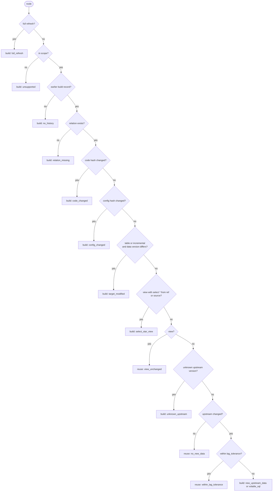

# Decision rules

The engine checks the rules in this order. The first rule that matches decides. The reason code goes into the record and the dbt log line.

| # | Condition | Decision | Reason code |
| --- | --- | --- | --- |
| 1 | mode is `shadow` | build anyway; the record keeps the decision and reason from rules 2-14 | reason from rules 2-14 |
| 2 | `--full-refresh`, or the node config sets `full_refresh: true` | build | `full_refresh` |
| 3 | resource type, materialization or incremental strategy is out of scope | build | `unsupported` |
| 4 | no earlier successful build record for this node | build | `no_history` |
| 5 | the relation is missing from the warehouse | build | `relation_missing` |
| 6 | the code hash differs from the record (with `compare_unrendered_code`: rendered and unrendered hashes both differ) | build | `code_changed` |
| 7 | the config hash differs from the record | build | `config_changed` |
| 8 | tables and incrementals only: the target's data version differs from the one recorded after its last build | build | `target_modified` |
| 9 | a view whose final `SELECT *` reads directly from a `ref()` or `source()` | build | `select_star_view` |
| 10 | the node is a view (its definition is unchanged, see rule 6) | reuse | `view_unchanged` |
| 11 | any upstream table has an unknown data version | build | `unknown_upstream` |
| 12 | no upstream changed since the last build (`any`), or not all of them changed (`all`) | reuse | `no_new_data` |
| 13 | upstream changed, but the last build is younger than `lag_tolerance` | reuse | `within_lag_tolerance` |
| 14 | otherwise | build | `new_upstream_data`, or `volatile_sql` when only volatile values changed |

A failure inside hodor gives `hodor_error` (build).

In `shadow` mode (rule 1) the flowchart still runs and its result is recorded, but the node builds.

## Terms

- **Upstream changed.** An upstream table's current data version differs from the version recorded for it at the node's last build. hodor compares for equality, not order, and the token holds the commit time, so a dropped and recreated table, or one swapped in from a staging table, still counts as changed.
- **Last build.** The `built_at_ms` of the latest record with action `build`. Reuse records do not reset the clock.
- **`require_fresh_data_from`.** `any` builds when any upstream has new data. `all` builds only when all of them have.
- **Views.** A view always shows current upstream data, so new data alone never rebuilds it (rule 10). Rule 10 comes before rule 11, because a view stores no data and an unknown upstream does not make it stale.
- **Seeds and snapshots.** Both store their own data, so they follow the table rules, including `target_modified`. A seed's code hash is the sha256 of its CSV file, and a seed has no upstream, so it builds only when the file, its config or its table changed. A snapshot's upstreams are the nodes and sources it selects from. `lag_tolerance` applies to snapshots too: set it under `snapshots:` in `dbt_project.yml`.
- **Model versions.** Each version of a versioned model is its own node, with its own relation (for example `customers_v2`) and its own records. A child's `ref('customers')` compiles to the relation of `latest_version`, so moving `latest_version` rebuilds the children with `code_changed`.
- **Volatile SQL.** A volatile function whose value decides rows or values (in `WHERE`, `JOIN`, a CTE, or a column computed from other columns) counts as an extra upstream: `volatile:date`, `volatile:session` or `volatile:always` (see [Hashing](hashing.md#volatile-functions)). It goes through rules 11-14 like a table, so `where d >= current_date() - 7` builds once a day, and a `current_timestamp()` filter builds when the last build is older than `lag_tolerance`. A new date or user counts as new data even with `require_fresh_data_from: all`. A stamp column, an output column of the final `SELECT` that reads no column (`current_timestamp() as _loaded_at`), does not count: on reuse it keeps the value of the last build. Views compute these functions when they are read, so they get no volatile upstreams.
- **Tests.** Tests use rules 2-8, 11, 12 and 14. Their upstreams are the nodes they test. `lag_tolerance` is always 0 for tests.
- **`target_modified`.** Something wrote to the table outside this node's builds. Maintenance commits such as `OPTIMIZE` do not change the data version, so they never trigger it.

## Reason codes in the log

A reused node shows its reason, for example `REUSED (no_new_data)`. A built node shows it too, for example `OK (new_upstream_data)`. A replayed test shows `PASS <test> (replayed)`.
