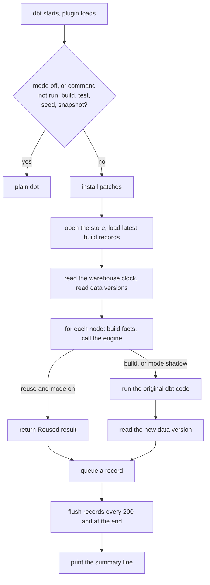

# Run flow

hodor loads inside the dbt process. A Databricks `dbt_task` job needs every command to start with `dbt`, so a wrapper CLI is not an option.

## Steps

1. **Plugin start.** With mode `off`, or for any command other than `run`, `build` or `test`, hodor installs nothing. If upstream `dbt_state` is also installed, hodor turns itself off with a warning, because both patch the same methods. On any adapter other than `databricks` or `duckdb`, hodor is off with a warning.
2. **Run start.** hodor opens the store and loads the latest record of every node in one query. It reads the warehouse clock in epoch milliseconds, so `lag_tolerance` does not depend on the local clock. It reads data versions in parallel, on `hodor_metadata_threads` threads.
3. **Each model.** dbt has already compiled the node. hodor builds the node facts and calls the engine.
    - Reuse (mode `on`): hodor returns dbt's `Reused` status without calling the materialization. Hooks do not run unless `execute_hooks_on_any_reuse` is `true`.
    - Build: hodor calls the original dbt code, then reads the table's new data version and queues a record.
4. **Each test.** Same flow. A replayed test returns its recorded status (pass, warn or fail) and failure count. The result line says `(replayed)`.
5. **Records** are queued in memory. They are written every 200 records and at the end of the run, also after errors and interrupts.
6. **Summary line.** `dbt-hodor: N reused, M built, K fail-open errors`.

## Fail open

An exception anywhere in hodor for a node is logged as a warning, and the node builds as plain dbt would (reason `hodor_error`). See [Operations](../operations.md#fail-open).

## Import cost

dbt imports every `dbt_*` module on every command, including `ls` and `parse`. `import dbt_hodor` therefore loads nothing heavy. sqlglot and duckdb load only when hodor is active for `run`, `build` or `test`.
